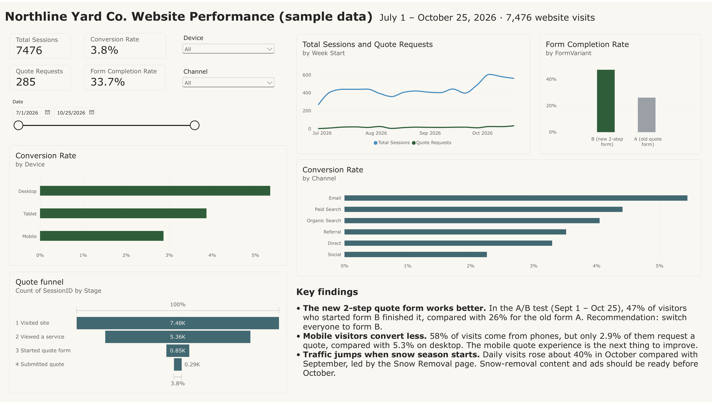

# Northline Yard Co. Website Performance Dashboard (Power BI)

A Power BI dashboard that analyzes website traffic, quote requests and an A/B test for **Northline Yard Co.**, a made-up landscaping and snow-removal company in Edmonton.

> **Sample data:** all numbers are made up for practice. Northline Yard Co. is not a real business.



## What the dashboard answers
- How many people visit the website, and how many request a quote?
- Which channels and devices bring visitors who actually convert?
- Does the new 2-step quote form work better than the old one?
- Where do visitors drop off before submitting a quote?

## Data
`Northline_Website_Sample_Data.xlsx` (also as CSV files), July 1 to October 25, 2026:
- **Sessions**: 7,476 website visits with date, channel, device, landing page, form version, and whether the visitor viewed a service, started the quote form and submitted it.
- **FunnelSteps**: one row for each funnel stage a visitor reached, linked to Sessions on `SessionID`.

## How it was built
1. **Power Query:** loaded the Excel tables and set column types (whole numbers, date, text).
2. **Data model:** created a many-to-one relationship from FunnelSteps to Sessions on `SessionID`.
3. **DAX measures:**
   ```DAX
   Total Sessions = COUNTROWS(Sessions)
   Quote Requests = SUM(Sessions[SubmittedQuote])
   Quotes Started = SUM(Sessions[StartedQuote])
   Conversion Rate = DIVIDE([Quote Requests], [Total Sessions])
   Form Completion Rate = DIVIDE([Quote Requests], [Quotes Started])
   ```
   Calculated column for weekly trends:
   ```DAX
   Week Start = Sessions[Date] - WEEKDAY(Sessions[Date], 2) + 1
   ```
4. **Report page:** KPI cards, weekly trend line, conversion by device and channel, A/B test chart, quote funnel, and date, device and channel slicers.
5. **Design:** consistent colours (green for success and the winning form, grey for the old form, blue for traffic) and a written key findings panel.

## Key findings
- **The new 2-step quote form works better.** 47% of visitors who started form B finished it, compared with 26% for the old form A.
- **Mobile visitors convert less.** 58% of visits come from phones, but only 2.9% request a quote, compared with 5.3% on desktop.
- **Traffic rises when snow season starts.** Daily visits were about 40% higher in October than in September.

## Files
| File | What it is |
|---|---|
| `Northline_Website_Dashboard.pbix` | Power BI Desktop file (open with Power BI Desktop on Windows) |
| `Northline_Website_Dashboard.pdf` | PDF export of the report |
| `Northline_Website_Dashboard.png` | Full-size image of the report |
| `Northline_Website_Sample_Data.xlsx` | Sample data used in the report |

## Tools
Power BI Desktop, Power Query, DAX, Excel

## Author
Samir Solanki · [solankisamir.com](https://solankisamir.com) · [GitHub](https://github.com/solankisamirh)
